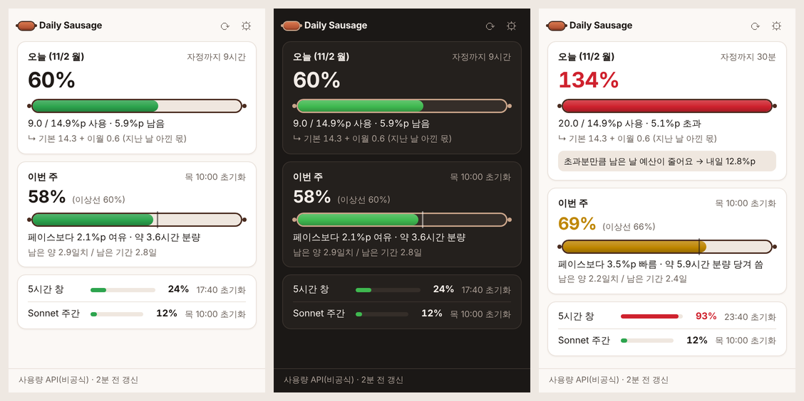

<p align="center"></p>

<h1 align="center">Daily Sausage</h1>

<p align="center">Claude 주간 사용량을 <b>오늘 쓸 수 있는 몫</b>으로 나눠서 트레이에 보여주는 앱</p>

> [!IMPORTANT]
> **Daily Sausage는 Claude 구독 사용량 전용 서드파티 프로그램입니다.**
> Anthropic이 만들거나 보증한 프로그램이 아니며, Anthropic과 아무 관련이 없습니다.
> "Claude"는 Anthropic의 상표이고, 이 프로그램이 어떤 서비스의 사용량을 보여주는지 설명하기 위해서만 이 이름을 사용합니다.



Claude 데스크탑은 주간 한도를 "초기화 전 ○요일 ○시쯤 소진됩니다"처럼 보여줍니다. 이 문구만으로는 오늘 얼마나 써도 괜찮은지 바로 감이 오지 않아서, Daily Sausage는 주간 한도를 하루 단위 예산으로 나눠서 보여줍니다. Windows 트레이와 macOS 메뉴 막대에서 동작합니다.

## 무엇을 보여주나요

### 오늘 예산 (재분배형, 기본값)

하루가 바뀔 때마다 이번 주에 남은 양을 초기화까지 남은 시간으로 다시 나눠서 오늘 몫을 정합니다.

```
오늘 예산 = (100 − 하루 시작 시점의 주간 사용률) × (오늘 구간 길이 ÷ 초기화까지 남은 시간)
         = 기본 몫(100 × 오늘 구간 / 168시간) + 이월분
```

- 어제 아껴 쓴 만큼 오늘 예산이 늘어나고, 많이 쓴 만큼 줄어듭니다. 팝업에 "기본 14.3 + 이월 0.6"처럼 나눠서 보여주므로 예산이 왜 바뀌었는지 알 수 있습니다.
- 날짜 수가 아니라 시간에 비례해서 나누기 때문에, 주간 초기화 시각이 하루 중간에 있어도 그날의 짧은 구간이 자동으로 맞춰집니다.
- 예산은 하루 경계에서만 다시 계산하므로, 쓰는 도중에 목표가 바뀌지 않습니다.
- 설정에서 **고정 1/7 + 이월 잔고** 방식으로 바꿀 수 있습니다. 이 방식은 매일 같은 기준(14.3%p)을 주고, 아끼거나 넘친 양을 잔고로 보여줍니다.

예를 들어 초기화가 목요일 10:00이고, 지금이 월요일 15:00이며, 월요일 자정에 주간 사용률이 49%, 지금은 58%라면 이렇게 계산됩니다.

| 항목 | 값 |
|---|---|
| 오늘 예산 | 14.9%p (기본 14.3 + 이월 0.6) |
| 오늘 사용 | 9.0%p → 오늘 예산의 60%, 남은 몫 5.9%p |
| 주간 페이스 | 시간 기준 이상선 60.1% 대비 2.1%p 여유 (약 3.6시간 분량) |
| 남은 양 | 2.9일치 / 초기화까지 2.8일 |
| 오늘 69%로 마감하면 | 내일 예산이 12.8%p로 줄어듭니다 |

### 그 밖의 표시

- **이번 주:** 주간 사용률, 시간 기준 이상선(게이지의 세로선), 페이스 차이를 시간 분량으로 환산한 값, 남은 양과 남은 기간을 같은 '일' 단위로 비교한 값을 보여줍니다.
- **5시간 창:** 5시간 사용량 창의 사용률과 초기화 시각을 보여줍니다.
- **모델별 주간 한도와 추가 사용량:** 사용량 API 조회를 켰고 계정에 해당 한도가 있으면 함께 보여줍니다.
- **트레이 아이콘:** 오늘 예산 사용률만큼 차오르는 소시지 모양입니다. 70% 미만은 초록, 100% 미만은 노랑, 100% 이상은 빨강이고, 데이터가 1시간 넘게 갱신되지 않으면 회색으로 바뀝니다. macOS에서는 메뉴 막대에 "60%" 같은 글자도 함께 표시합니다.
- **알림:** 오늘 예산 80% 도달, 오늘 예산 초과(내일 예산이 얼마로 줄어드는지 포함), 5시간 창 90% 사용을 하루에 한 번씩 알려줍니다.

## 설치

[Releases](../../releases) 또는 [Actions](../../actions)의 최신 빌드 아티팩트에서 설치 파일을 받습니다.

- **Windows:** `Daily Sausage_x.y.z_x64-setup.exe`를 실행합니다. 코드 서명이 되어 있지 않아서 SmartScreen 경고가 뜨면 "추가 정보" → "실행"을 누릅니다.
- **macOS:** `.dmg`를 열고 **Daily Sausage.app을 '응용 프로그램' 폴더로 옮긴 뒤** 실행합니다. 서명되지 않은 앱이라 처음에는 앱을 우클릭해서 "열기"를 선택해야 합니다. 그래도 열리지 않으면 터미널에서 아래 명령을 한 번 실행합니다.

```bash
xattr -dr com.apple.quarantine "/Applications/Daily Sausage.app"
```

처음 실행하면 팝업이 열립니다. 설정(⚙)에서 아래 데이터 경로 중 하나 이상을 켜 주세요.

## 사용량 데이터를 가져오는 방법

Anthropic은 구독 잔여 사용량을 위한 공개 API를 제공하지 않습니다. Daily Sausage는 퍼센트 값만 다루며, 토큰 수 같은 절대량은 알 수 없습니다.

### 1. Claude Code 연동 (공식 경로, 기본)

Claude Code는 [상태줄 스크립트](https://code.claude.com/docs/en/statusline)에 `rate_limits.five_hour`와 `rate_limits.seven_day`(사용률, 초기화 시각)를 전달합니다. 설정의 **연동 설치**를 누르면 Claude Code 설정 파일(`~/.claude/settings.json`, `CLAUDE_CONFIG_DIR`을 쓰면 그 아래)의 `statusLine`을 아래처럼 바꿉니다.

```json
"statusLine": { "type": "command", "command": "\"<설치 경로>/daily-sausage\" collect" }
```

- 적용하기 전에 바뀌는 내용을 먼저 보여주고, 원본은 `settings.json.daily-sausage-backup-<시각>`으로 백업합니다.
- 기존 상태줄 명령이 있으면 그 명령을 같은 입력으로 이어서 실행하므로, 상태줄 모양은 그대로 유지됩니다. 기존 상태줄이 없으면 "오늘 ▓▓▓▓▓▓░░░░ 60% (5.9%p 남음) │ 주 58% (+2.1 여유) │ 5h 24%" 같은 요약 한 줄을 보여줍니다(설정에서 끌 수 있음).
- **연동 제거**를 누르면 원래 `statusLine`으로 되돌립니다.
- 한계: Claude Code가 응답을 받을 때만 값이 들어옵니다. Claude 데스크탑 앱이나 웹에서 채팅으로 쓴 양은 다음 Claude Code 응답 때 함께 반영됩니다. Pro, Max, Ultra 구독에서만 이 값이 제공됩니다.

### 2. 사용량 API 조회 (비공식, 개인용 선택 기능, 기본값 꺼짐)

Claude Code의 `/usage` 명령이 내부적으로 호출하는 `https://api.anthropic.com/api/oauth/usage`를, Claude Code에 저장된 **본인의** claude.ai 로그인으로 조회합니다. Claude Code를 쓰지 않을 때도 값이 갱신되고, 채팅에서 쓴 양도 바로 반영됩니다.

> [!WARNING]
> - 문서화되지 않은 내부 API라서 Anthropic이 언제든 바꾸거나 막을 수 있습니다.
> - [Claude Code 약관 문서](https://code.claude.com/docs/en/legal-and-compliance)에는 서드파티 개발자가 Claude.ai 자격 증명을 수집, 저장, 중개하면 안 된다는 조항이 있습니다. 본인 PC에서 본인 로그인으로 조회만 하는 용도이지만 회색지대일 수 있으니, 본인 판단으로 켜 주세요.
> - Team 좌석 등 일부 계정에서는 403 응답을 받을 수 있으며, 이 경우 조회를 자동으로 멈춥니다.

토큰은 이렇게 다룹니다.

- **읽는 위치:** Windows와 Linux는 `%USERPROFILE%\.claude\.credentials.json`(또는 `CLAUDE_CONFIG_DIR` 아래), macOS는 키체인 항목 `Claude Code-credentials`를 먼저 읽고 없으면 같은 파일을 읽습니다. macOS에서는 처음 한 번 키체인 접근 허용 창이 뜨는데, "항상 허용"을 누르면 됩니다.
- **쓰는 방법:** 토큰은 메모리에서만 쓰고, 파일로 저장하거나 로그에 남기거나 `api.anthropic.com` 외의 곳으로 보내지 않습니다.
- **갱신:** Daily Sausage는 토큰을 직접 갱신하지 않습니다. 직접 갱신하면 refresh token이 교체되어 Claude Code 로그인이 풀릴 수 있고, refresh token을 다루는 것 자체가 약관에서 금지하는 자격 증명 중개에 해당하기 때문입니다. 대신 토큰이 만료되면(만료 1분 전부터) Claude Code의 `/usage` 명령을 `claude -p /usage`로 창 없이 실행합니다. Claude Code는 시작할 때 만료된 로그인을 스스로 갱신하고, `/usage`도 같은 사용량 API를 조회하므로 유효한 로그인이 필요합니다. 갱신된 로그인은 Claude Code가 자기 방식(파일 또는 키체인, 잠금 포함)으로 저장하고, Daily Sausage는 저장된 로그인을 다시 읽기만 합니다.
  - `/usage`는 Claude Code 안에서 처리되는 명령이라 모델에 메시지를 보내지 않으므로, 구독 사용량을 쓰지 않습니다. 다만 `/usage` 명령이 없는 아주 오래된 Claude Code는 이 입력을 일반 메시지로 보낼 수 있으니, Claude Code를 최신 버전으로 유지해 주세요.
  - 흔적이 남지 않도록 세션을 저장하지 않고(`--no-session-persistence`), MCP 서버를 띄우지 않으며(`--strict-mcp-config`), 안전 모드(`CLAUDE_CODE_SAFE_MODE=1`)로 실행해서 사용자 훅과 플러그인도 건너뜁니다. 프록시 같은 설정의 `env`는 그대로 적용됩니다.
  - 공식 기능이 아니라 Claude Code가 이렇게 동작한다는 점에 기대는 방식이라서, 이후 버전에서 동작이 바뀔 수 있습니다. 갱신되지 않으면 경고 문구가 뜨고, 이때는 Claude Code를 한 번 실행하면 다시 이어집니다.
  - 실패가 반복되면 30분에 한 번(팝업을 열 때는 2분에 한 번)만 다시 시도합니다.
  - `claude` 실행 파일은 `PATH`와 일반적인 설치 위치(`~/.local/bin`, `~/.claude/local`, `/opt/homebrew/bin`, `/usr/local/bin`, Windows의 `%USERPROFILE%\.local\bin`, `%APPDATA%\npm`)에서 찾습니다. 찾지 못하면 `config.json`의 `claude_path`에 경로를 적고 앱을 다시 시작합니다.
  - 설정에서 **만료되면 Claude Code로 자동 갱신**을 끄면 예전처럼 조회만 건너뜁니다.
- **조회 주기:** 기본 5분(2–15분 설정)이고, 하루 경계 직후와 팝업을 열 때도 조회합니다(최소 60초 간격). 429나 서버 오류를 받으면 간격을 두 배씩 늘려 최대 30분까지 기다립니다.

## 설정

| 항목 | 기본값 | 설명 |
|---|---|---|
| 하루가 바뀌는 시각 | 00:00 | 자정을 넘겨 작업하는 날이 많다면 04:00처럼 늦출 수 있습니다. |
| 표시 방식 | 재분배형 | 재분배형 오늘 예산 / 고정 1/7 + 이월 잔고 |
| Claude Code 연동 | 설치 안 됨 | 위의 공식 경로를 설치하거나 제거합니다. |
| 요약 한 줄 표시 | 켜짐 | 기존 상태줄이 없을 때 Claude Code 상태줄에 요약을 보여줍니다. |
| 사용량 API 조회 | 꺼짐 | 위의 비공식 경로입니다. 처음 켤 때 안내를 확인해야 합니다. |
| 조회 간격 | 5분 | 2, 3, 5, 10, 15분 |
| 만료되면 Claude Code로 자동 갱신 | 켜짐 | 로그인이 만료되면 `claude -p /usage`를 창 없이 실행해서 Claude Code가 직접 갱신하게 합니다. 사용량 API 조회를 켰을 때만 동작합니다. |
| 알림 | 모두 켜짐 | 오늘 예산 80%, 오늘 예산 초과, 5시간 창 90% |
| 로그인할 때 자동 시작 | 켜짐 | |

## 데이터 저장 위치

| OS | 경로 |
|---|---|
| Windows | `%APPDATA%\daily-sausage\` |
| macOS | `~/Library/Application Support/daily-sausage/` |
| Linux | `~/.local/share/daily-sausage/` |

- `samples.jsonl`: 사용률 기록입니다(최근 14일만 보관).
- `config.json`: 설정입니다. 앱과 상태줄 수집기가 함께 읽습니다.
- `notify_state.json`: 오늘 보낸 알림 목록입니다.

`DAILY_SAUSAGE_DATA_DIR` 환경 변수로 위치를 바꿀 수 있습니다.

## 개발

```
crates/core/        순수 로직 (계산, 파싱, 저장, 문구, 아이콘, 수집기, 설정 연동)
app/                Tauri v2 앱 (TypeScript 팝업 + Rust 트레이)
app/src-tauri/      트레이, 팝업 창, 백그라운드 갱신, 명령
```

필요한 도구는 Rust(stable 1.89 이상), Node.js 22, 그리고 [Tauri 사전 요구 사항](https://v2.tauri.app/start/prerequisites/)입니다.

핵심 로직 테스트:

```bash
cargo test -p daily-sausage-core --all-features
```

개발 모드로 실행:

```bash
cd app && npm ci && npm run tauri dev
```

설치 파일 빌드:

```bash
cd app && npm run tauri build
```

팝업 화면만 브라우저에서 확인하기 (`?state=over`, `?state=empty`, `?state=fixed`, `?view=settings`로 상태를 바꿀 수 있습니다):

```bash
cd app && npm run dev
```

수집기를 직접 시험해 보기:

```bash
echo "{\"rate_limits\":{\"seven_day\":{\"used_percentage\":58,\"resets_at\":$(( $(date +%s) + 3*86400 ))}}}" | target/debug/daily-sausage collect
```

`main` 브랜치에 push하면 GitHub Actions가 테스트를 돌리고 Windows(NSIS)와 macOS(유니버설 dmg) 설치 파일을 아티팩트로 만듭니다. `v*` 태그를 push하면 초안 릴리스도 만듭니다.

## 실제 PC에서 확인할 것

1. 설치 후 트레이 아이콘이 나타나고, 클릭하면 팝업이 아이콘 근처에 열립니다.
2. 설정에서 Claude Code 연동을 설치하고 Claude Code에 메시지를 한 번 보내면, 30초 안에 트레이 값이 바뀝니다.
3. 사용량 API 조회를 켜면 값이 Claude 데스크탑의 설정 > 사용량 화면과 일치합니다.
4. 하루가 바뀌는 시각을 바꾸면 오늘 예산이 다시 계산됩니다.
5. 로그인이 만료되면 자동으로 갱신됩니다.
   - Windows/Linux: Claude Code를 모두 종료하고 `.credentials.json`을 백업한 뒤, `expiresAt`을 과거 값(예: `1700000000000`)으로 바꿉니다. 팝업을 열면 1분 안에 사용량 API 경고가 사라지고, 파일의 `accessToken`과 `expiresAt`이 새 값으로 바뀝니다.
   - macOS: Claude Code를 몇 시간 쓰지 않아서 토큰이 자연스럽게 만료된 뒤에도 값이 계속 갱신되는지 확인합니다.

## 라이선스

[MIT](LICENSE)
